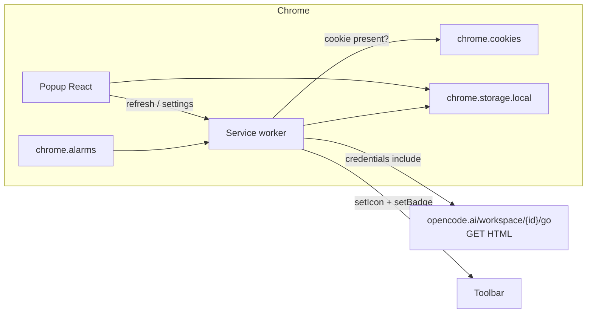

# Architecture — OpenCode Go Pacer

Chrome extension (Manifest V3). No backend. All data stays on-device. Not affiliated with OpenCode / Anomaly.

Master product spec: [opencodego-brief.md](opencodego-brief.md). Fetch contract: [opencodego-feasibility.md](opencodego-feasibility.md).

## Context

The extension reads the user's existing `opencode.ai` web session, pulls current usage from `https://opencode.ai/workspace/{workspaceID}/go`, computes a linear pace on the **weekly** window, and shows:

- Toolbar **icon**: elapsed-time ring of the **weekly** `averagePct` (0–100% at reset).
- Toolbar **badge**: one number (remaining / delta / used) + pace color. Based on the **weekly** window.
- **Popup**: two pills (elapsed % vs used %), pace label, weekly forecast, rolling/monthly mini-cards, settings.

The **weekly window is the primary pacing target**. **Rolling and monthly windows are display-only**.

## System diagram

## Layers

| Layer | Path | Responsibility |
|-------|------|----------------|
| Domain | `src/domain/` | Pure pacing math and view-model (weekly pacing, rolling/monthly display). No `chrome.*`. |
| OpenCode client | `src/opencode/` | Cookie presence, `GET /go` fetch, SSR HTML parse. |
| Cache | `src/storage/` | `chrome.storage.local` snapshot + settings. Never stores the cookie. |
| Toolbar | `src/toolbar/` | Canvas ring icon + badge text/color. |
| Background | `src/background/` | Alarm, orchestrate fetch → math → icon/badge. |
| Popup | `src/popup/` | React UI. Reads cache; can request a refresh. |

## Runtime

- **Service worker** is the only privileged context. It owns alarms, cookie checks, network, and `chrome.action.setIcon` / `setBadgeText` / `setBadgeBackgroundColor`.
- **Popup** is ephemeral. On open it reads cache, then asks the worker to refresh.
- **Host fetch:** `https://opencode.ai/workspace/{workspaceID}/go` with `credentials: "include"`. MV3 `host_permissions` attach session cookies automatically; do not copy cookie values into storage or logs.
- **Signed-out detection:** `chrome.cookies.getAll({ url: "https://opencode.ai/" })` returns no session cookie → signed out. Use presence only.

## Icon drawing

Draw 16×16 and 32×32 `ImageData` via `OffscreenCanvas` in the worker. Fallback: `chrome.offscreen` document if `OffscreenCanvas` is missing.

- Track: dark ring. Fill: an arc from 12 o'clock, clockwise, `averagePct / 100` of 360°. Brand-neutral accent color distinct from the pace colors.
- Ring color is **not** pace (time ≠ usage). Pace is badge background only.
- Empty grey track when signed out with no usable cache.

## Cache schema

`chrome.storage.local` keys:

| Key | Type | Notes |
|-----|------|-------|
| `snapshot` | `UsageSnapshot` | Last successful parse plus `fetchedAt`. |
| `badgeMode` | `"remaining" \| "delta" \| "used"` | Default `"remaining"`. Weekly window. |
| `refreshInterval` | `"5min" \| "15min" \| "manual"` | Default `"15min"`. Background alarm only. |
| `lastError` | `string \| null` | Fetch/parse failure message for popup. |

`UsageSnapshot.fetchedAt` is epoch ms. Stale = signed out **and** `now - fetchedAt >= 24h` → badge `—`, empty ring. Signed out **and** cache younger than 24h → dim badge + ring from snapshot.

The snapshot holds all three windows (structurally separated), with the weekly window flagged as the pacing target.

## Refresh

- Background alarm: **5 minutes**, **15 minutes** (default), or **manual** (no alarm). Setting is `refreshInterval` in storage.
- Always: popup open, manual Refresh button, extension install/startup.
- Changing the interval updates the alarm immediately and does not fetch.
- No exponential backoff in MVP.

## Error states

| State | Toolbar | Popup |
|-------|---------|-------|
| OK | Ring + colored badge | Two pills + details |
| Signed out, fresh cache | Dim badge, cached ring | Sign-in prompt + last numbers |
| Signed out, stale/none | Grey `—`, empty ring | Sign-in prompt |
| Fetch/parse fail, have cache | Keep last | Error line + last synced |
| Fetch/parse fail, no cache | Grey `—` | Error + sign-in |

## Out of scope (do not build)

Notifications, history chart, i18n, account switcher, refresh backoff, per-model breakdown, storing cookies, calling extra endpoints (the plan page is enough).
